## Design log — 2026-10-19 — Code Croak, hi-fi prototype

**Session goal:** Make the hi-fi prototype of Code Croak. I gave Claude my style guide and my moodboard together with my lo-fi wireframes, so it could build the clickable app from them.

> Quotes are my own words from the chat, only the spelling is tidied.

### Key moments

#### Building the hi-fi

**Hi-fi built from my lo-fi wireframes** · started by designer

- What happened: I gave the AI my style guide and my moodboard together with my lo-fi wireframes, the teacher's AGENTS.md and the design.md approach from the slides (Vercel). The AI built the clickable prototype with HTML, CSS, JavaScript and beer.css, using the components of my style guide, and a DESIGN.md with the style guide rules.
- Decision: Follow my wireframes and my style guide, plus the iteration 3 change. Colours only live in CSS variables, not in DESIGN.md.
- Why: "Based on my lo-fi wireframes I want you to take that design and put it to use, as well as what I mention for another iteration of design (very important)."

**Spacing, bubbly navigation, logo and name** · started by designer

- What happened: I tested the first version: no padding between buttons, no space between logo and app name, simple icons in the navigation.
- Decision: More space between buttons, a bubbly tab bar with a coloured active tab, space between logo and name, hover colours from the style guide.
- Why: "There is barely any spacing, the buttons don't seem to have padding. Since the app is so bubbly and nice, the icons being simple makes no sense."

**Hover only on clickable things, responsive on iPhone 16** · started by designer

- What happened: Things that cannot be clicked had a hover, and the page went outside the screen at iPhone 16 size.
- Decision: Hover removed from labels and text, layout and long code lines wrap on small screens.
- Why: "If there are things that cannot be clicked, remove hover." And: "If I put iPhone 16 it looks like things are going out."

**Requirements dropdown** · started by designer

- What happened: I liked that the requirements list is collapsed, but when opened it looked unchanged.
- Decision: The open state gets its own style.
- Why: "The requirements list is packed in, I like that, but when I click on it, it looks like it doesn't have any style change."

**Only one "Back to Feedback"** · started by designer

- What happened: The AI added a second "Back to Feedback" button under the explanation.
- Decision: Removed, only the back arrow at the top stays.
- Why: "There is no point in a button back to feedback under the explanation, since the back button at the top does the same. My wireframes had the top one only."

**Dark mode left out for now** · started by designer

- What happened: The AI built a light and a dark theme with a setting.
- Decision: Removed completely, the app only has the light theme. I will ask about dark mode in the next test.
- Why: "Or should I leave light/dark mode out and see if that is something we need to add or not?"

**"Start reviewing" and a clearer Add comment** · started by designer

- What happened: The button said "Continue reviewing". The AI first made Add comment slightly grey before a line is selected and light green after. I felt that was not very visible.
- Decision: Label is now "Start reviewing". Add comment is grey until a line is selected, then it is filled with dark green (Lily).
- Why: It is not very visible when it is only light green. When it is filled with green it looks more obvious that the student should add a comment for the line.
- 🖼️ Before: 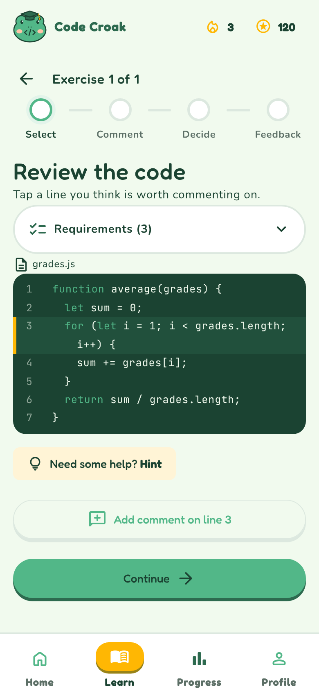 After: 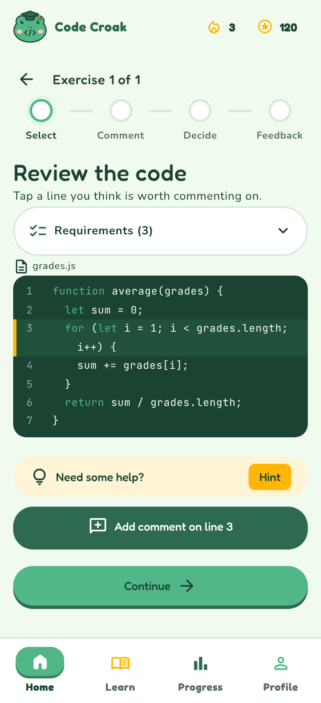

**Hint bar the same size as the other buttons** · started by designer

- What happened: The AI designed the Hint button about half the size of the other buttons. My lo-fi wireframe had it differently, so I sent the wireframe again.
- Decision: Full-width Hint bar, like in my wireframe.
- Why: It has to be the same size as the rest, so it keeps the style of the other buttons.
- 🖼️ Before:  After: 

**Explanation/Expert switch: the AI missed my wireframes** · started by designer

- What happened: The AI built underlined text tabs. My wireframes had two rounded bordered buttons next to each other. I had to send the wireframes again.
- Decision: Rebuilt it exactly like the wireframes.
- Why: "These are not like in my wireframes, they were more like rounded borders."
- 🖼️ Before: 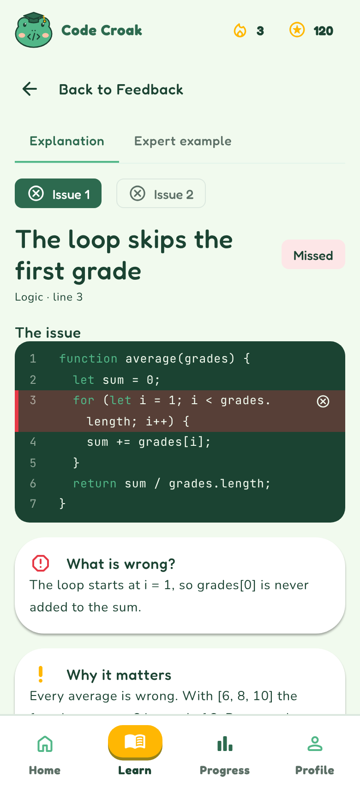 After: 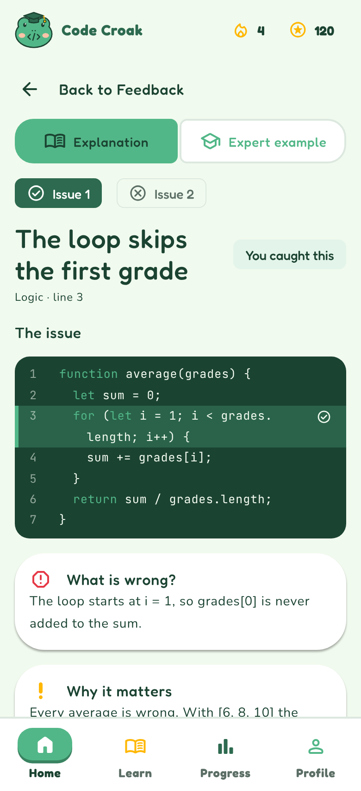

**Pass or redo a lesson** · started by designer

- What happened: In the first logic a student completed a lesson, got points and the lesson disappeared from Home even if they missed issues.
- Decision: A lesson only counts as completed, gives points and leaves Home when all issues are found and the decision is right. Otherwise the screen says "Almost there!" with a "Redo lesson" button and the lesson stays on Home as "Continue learning".
- Why: "It doesn't make sense that I completed the lesson if I didn't pass it." I thought it was important to show the flow when you do not find the issues, because the first version still gave points in that case.
- 🖼️ 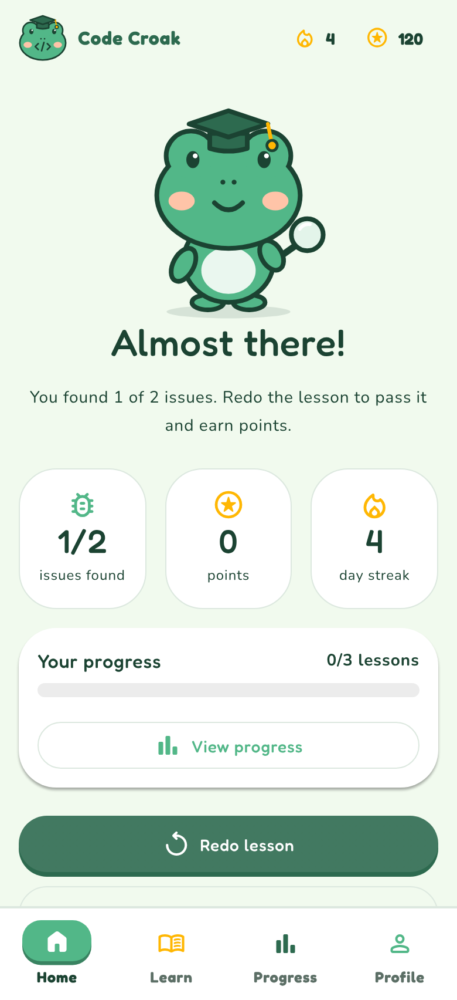

**Expert example spacing** · started by designer

- What happened: The code block overlapped the text above it.
- Decision: Moved the code block down a bit.
- Why: Purely visual. The code block overlapped a bit with the explanation, so I suggested padding in between.

**Learn tab = study material** · started by designer

- What happened: The Learn tab first listed lessons to practise. I explained what I had in mind, because I had no lo-fi wireframe for it: chapters with a name and an overview of learning objectives, and a detail page with more info.
- Decision: Learn only has reading material. Practising starts from Home, so Learn is not highlighted while in a lesson.
- Why: "Something they can learn without practising, just like study materials."
- 🖼️ Before: 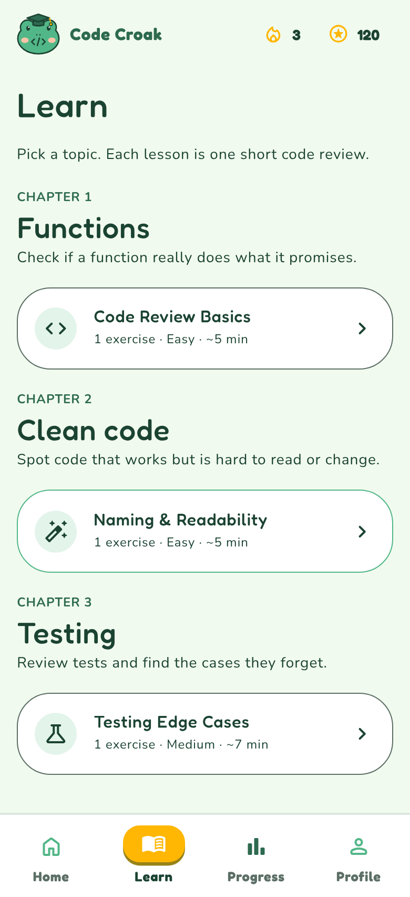 After: 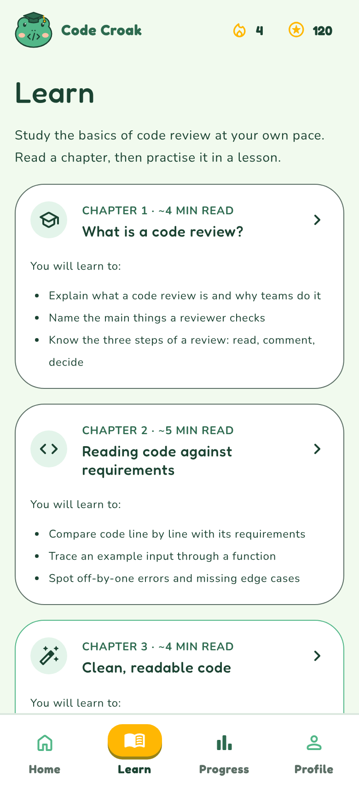

**Lesson Complete screen with optional View Progress (iteration 3)** · started by designer

- What happened: I asked for a new screen after the feedback that shows what the student achieved and offers an optional way to check progress.
- Decision: New screen with issues found, points, streak, progress bar and a "View progress" button. It is optional, the student can also go back to Home.
- Why: "I thought it is important to show the flow if you do not get the issues." The first version gave points even then, which did not make sense.
- 🖼️ 

#### Things the AI added that I did not ask for, and kept

**Onboarding questions** · started by AI

- What happened: I had no onboarding in my lo-fi wireframes. The AI added three short questions after sign-up (language, experience, reviews per week), skippable.
- Decision: Kept.
- Why: I liked it because it shows the flow of where you start, with your level and programming language. That is what makes a good onboarding.
- 🖼️ 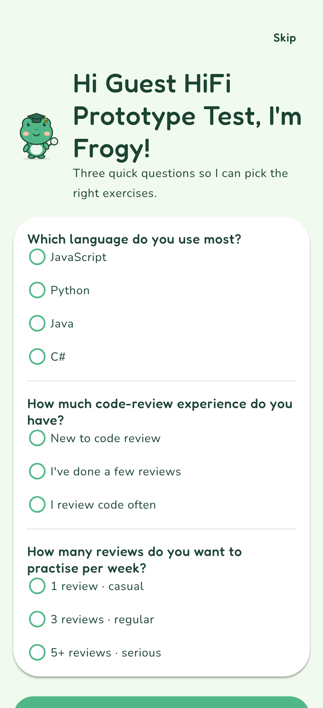

**Error prevention on log in** · started by AI

- What happened: I did not have a login in my lo-fi drawings, but I knew the app would have one, with an email or username and a password, and "Try for free". The AI added it with messages when the email or password is empty or wrong.
- Decision: Kept.
- Why: Error prevention is needed, and I liked that the validation is simple and understandable. Error validation was always on my mind, and I mentioned things like it in my document. I liked that I did not have to say it. If I needed it, I would have had no problem asking for it.
- 🖼️ 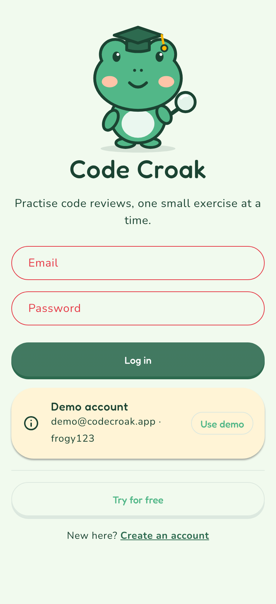

**Note when there are no comments** · started by AI

- What happened: When the student continues without any comment, the decision screen says "You did not leave any comments. You can still submit, or go back to the code."
- Decision: Kept.
- Why: It makes absolute sense and shows that the flow is there. If you do not have a comment, the app asks you to verify that this is correct. I could also see this coming from my lo-fi myself, and I would probably have added it if I had made the hi-fi myself.
- 🖼️ 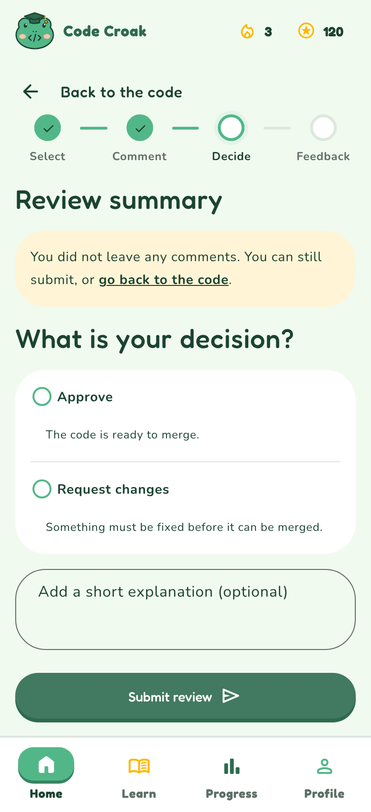

**Tabs for multiple issues in one exercise** · started by AI

- What happened: When an exercise has more than one issue, the explanation screen shows "Issue 1 / Issue 2" tabs, each with a check or cross, so every issue is explained separately.
- Decision: Kept.
- Why: I liked that every issue gets the same amount of explanation and is focused on separately, because they are probably different issues. I could also see this coming from my lo-fi myself, and I would probably have added it if I had made the hi-fi myself.
- 🖼️ 

**Reset demo data in Profile** · started by AI

- What happened: The AI added a "Reset demo data" button.
- Decision: Kept, even though it is not a real app feature.
- Why: I did not think I needed it at first, but when I test the hi-fi prototype with ICT students it will come in handy, so they do not start with someone else's progress before they review themselves.

#### Last changes in this session

**Comments default to "Request changes"** · started by designer

- What happened: I asked that after adding a comment the decision is preselected on Request changes, but the student can still choose Approve.
- Decision: If there is at least one comment, Request changes is preselected. Without comments nothing is preselected. Approve can always be selected.
- Why: "If you add a comment then it should kind of default to request changes, but it's also possible to change it, so the user has the option to approve even with the comment."
- 🖼️ 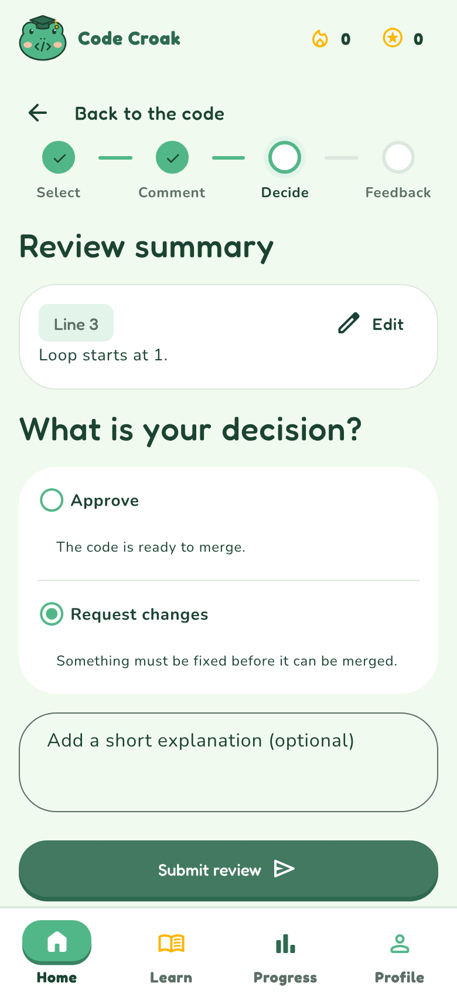

**Longer guest name** · started by designer

- What happened: I asked for a longer name for the "Try for free" guest account to check that long names do not break the layout.
- Decision: Guest is now called "Guest HiFi Prototype Test". Names wrap on Home, Onboarding and Profile instead of being cut off.
- Why: "A longer name, so we make sure the style fits and the name doesn't get cut off."
- 🖼️ 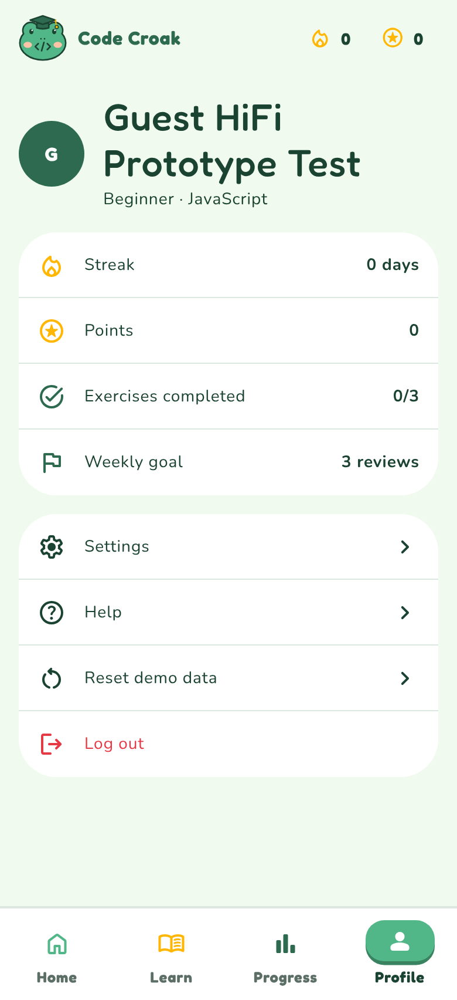

### AI suggestions not used

- A light and dark theme with a setting (removed, see above).
- A second "Back to Feedback" button under the explanation.

### Who did what

- **AI:** built the clickable prototype (HTML, CSS, JavaScript, beer.css) from my wireframes, style guide and moodboard, wrote DESIGN.md and README, and suggested the onboarding questions, login messages, no-comments note, issue tabs and reset button.
- **Designer:** made the lo-fi wireframes, the moodboard and the style guide, tested every version and decided what to change (spacing, navigation, hover, responsive, hint bar, switch, pass/redo, Learn page, Request changes default, guest name), chose which AI extras to keep, and set the iteration 3 improvement.

---

## Design log — 2026-10-24 — Code Croak, after the final usability test

**Session goal:** Process the feedback of the final usability test and finish the hi-fi prototype.

### Key moments

**Whole "Back to Feedback" is clickable** · started by designer (from the usability test)

- What happened: Hanneke expected the text of "← Back to Feedback" to be clickable as well, not only the arrow. She still understood the action and found the way back quickly.
- Decision: Arrow and text are now one clickable link, on every screen that has a back row.
- Why: "Hanneke expected the complete Back to Feedback element to be clickable, including both the arrow and the text."
- 🖼️ 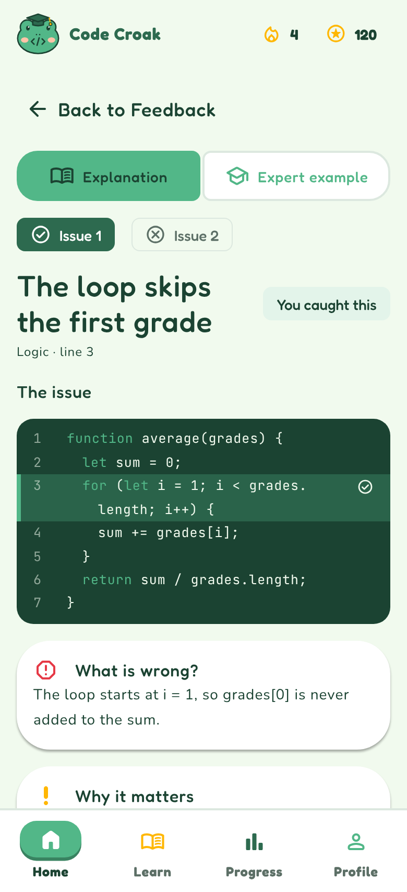

**Onboarding needs all three answers** · started by designer

- What happened: I had not noticed that the onboarding had no validation. It is not required to answer, because there is a Skip button, but when the student presses Continue without answering, the app went to Home without checking the three questions (language, level, reviews per week).
- Decision: Continue now stays on the screen and shows "Choose an answer to continue." under each unanswered question. Students who do not want to answer can still use Skip at the top.
- Why: "If the user wants to skip them they have the skip option, but if you press Continue there should be validation on the fields."
- 🖼️ 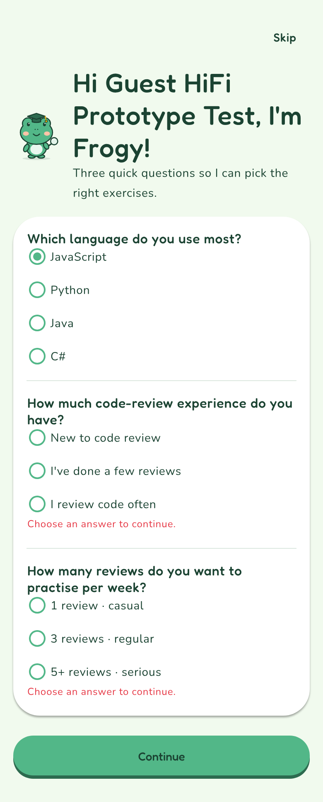

**Login errors need a message** · started by designer

- What happened: When the login failed or fields were empty, the fields only turned red, without a message. I noticed this while checking the error messages of the other screens.
- Decision: Every problem now has a plain-language message: "Enter your email address.", "Enter a valid email address.", "Enter your password." and "Email or password is not correct." for a wrong combination.
- Why: "So the user gets help and can recover from errors. The errors should be in plain language."
- 🖼️ 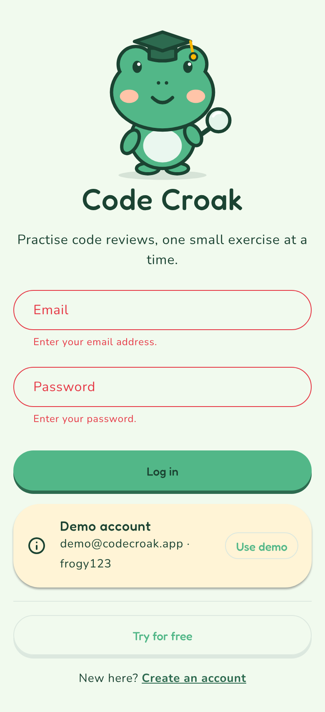 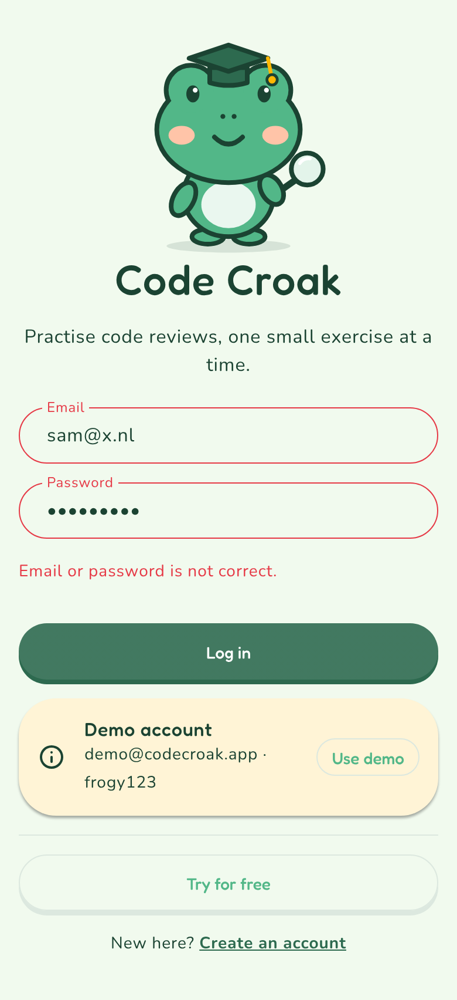
